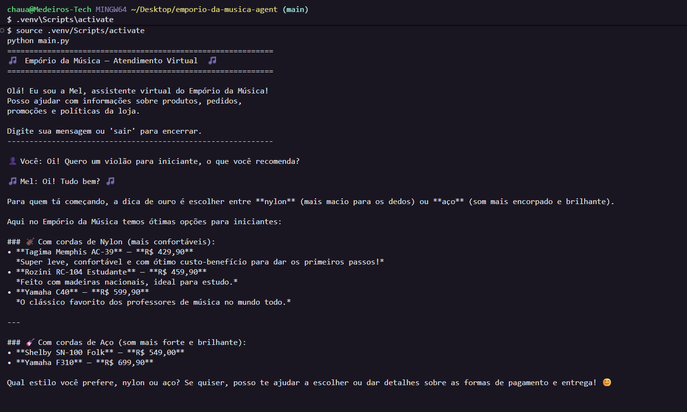
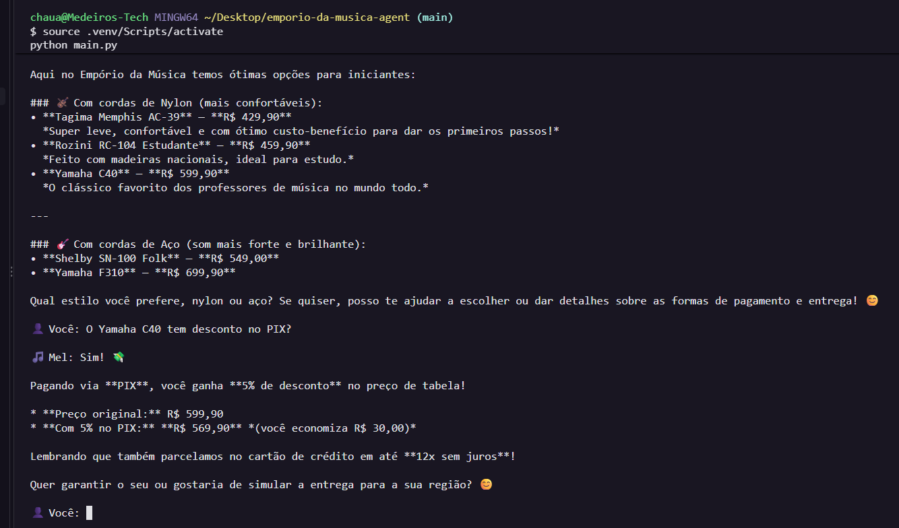

# 🎵 Empório da Música - Customer Service Agent


Intelligent conversational agent for the customer service of **Empório da Música**, a musical instrument store located in Campo Grande/MS, Brazil. The agent simulates a WhatsApp-style service channel, answering questions about products, orders, promotions, and store policies.

> **Note on language:** The documentation and code comments are in English, but the agent itself talks to customers in **Brazilian Portuguese** on purpose - it serves a Brazilian store, so the persona, the chat dialogues in `examples/`, and the data remain in Portuguese.

## 📋 Table of Contents

- [Demo](#-demo)
- [How to Run](#-how-to-run)
- [Architecture](#-architecture)
- [Technical Decisions](#-technical-decisions)
- [Project Structure](#-project-structure)
- [Interaction Examples](#-interaction-examples)
- [Known Limitations](#-known-limitations)
- [AI Usage in Development](#-ai-usage-in-development)

## 🎬 Demo

A real `python main.py` session: Mel helps a beginner choose a guitar, then explains the PIX payment discount - always grounding her answers in the store's actual catalog and prices.





## 🚀 How to Run

### Prerequisites

- Python 3.10+
- Google Gemini API key (free)

### Step by Step

1. **Clone the repository:**
```bash
git clone https://github.com/chauvmedeiros/emporio-da-musica-agent.git
cd emporio-da-musica-agent
```

2. **Create and activate a virtual environment:**
```bash
python -m venv .venv
source .venv/bin/activate  # Linux/Mac
# .venv\Scripts\activate   # Windows
```

3. **Install dependencies:**
```bash
pip install -r requirements.txt
```

4. **Configure the API key:**

Get a free key at [Google AI Studio](https://aistudio.google.com/apikey) and create the `.env` file:
```bash
cp .env.example .env
# Edit .env and paste your key
```

5. **Run:**
```bash
python main.py
```

## 🏗️ Architecture

```
┌─────────────────────────────────────────────────┐
│                    CLI (main.py)                 │
│                 User Interface                   │
└──────────────────────┬──────────────────────────┘
                       │
┌──────────────────────▼──────────────────────────┐
│              ChatSession (agent.py)              │
│               Conversation History               │
└──────────────────────┬──────────────────────────┘
                       │
┌──────────────────────▼──────────────────────────┐
│          ReAct Agent (LangChain)                 │
│      Google Gemini 3.5 Flash + Tool Calling      │
└──────────┬───────┬───────┬───────┬──────────────┘
           │       │       │       │
     ┌─────▼──┐ ┌──▼───┐ ┌▼─────┐ ┌▼──────────┐
     │Products│ │Orders │ │Promos│ │ Policies   │
     │ (CSV)  │ │ (CSV) │ │(CSV) │ │  (PDF)     │
     └────────┘ └──────┘ └──────┘ └────────────┘
```

The agent uses the **ReAct** approach (Reasoning + Acting): on each customer message, the model decides which tools to call, analyzes the results, and composes a contextualized answer.

## 🔧 Technical Decisions

### 1. Framework: LangChain with Tool Calling

**Choice:** LangChain 1.x (`create_agent`)

**Rationale:** LangChain's `create_agent` offers a mature abstraction for building agents with tools, with native support for Gemini's tool calling (function calling). This lets the model autonomously decide which tools to call based on the customer's question, without manual conditional logic. Under the hood it builds a ReAct agent on top of LangGraph, which keeps the code simple for this use case (a customer service agent with lookup tools) while leaving the door open for more complex stateful flows in the future.

**Alternatives considered:**
- **Hand-rolled LangGraph:** Building the graph manually gives more control over state and conditional routing, but adds unnecessary complexity for this case
- **Manual implementation with the Gemini SDK:** Lower abstraction, more control, but requires reimplementing the ReAct loop and tool management
- **Pure RAG:** Limited for structured queries (CSV); better suited for long, unstructured documents

### 2. Model: Google Gemini 3.5 Flash

**Choice:** `gemini-3.5-flash` via Google AI Studio (free tier)

**Rationale:** It offers an excellent cost/performance ratio for conversational agents. It supports native tool calling (essential for the ReAct approach), understands Brazilian Portuguese well, and the free tier is enough for development and demonstration. Flash's low latency is ideal for simulating real-time service.

**Alternatives considered:**
- **GPT-4o (OpenAI):** Excellent quality, but a significantly higher cost per token
- **Claude (Anthropic):** Great at Portuguese and reasoning, but no free API tier
- **Open-source models (Llama, Mistral):** Require hosting infrastructure and have weaker tool-calling performance

### 3. Approach: ReAct Agent with Tools

**Choice:** ReAct agent with 6 specialized tools

**Rationale:** Each tool encapsulates a specific query over the store's data:
- `search_products` - Search by name, category, or description
- `check_product_by_id` - Details of a specific product
- `check_active_promotions` - List active promotions
- `track_order` - Track by ID, code, name, or e-mail
- `lookup_customer` - Look up customer records
- `consult_store_policies` - Query the policies PDF

This separation lets the model decide which sources to consult based on context, and it can combine multiple tools in a single answer (e.g., search for a product + check a promotion).

**Alternatives considered:**
- **SQL Agent:** Convert the CSVs into a SQLite database and use SQL queries. More flexible for complex queries, but adds a layer of complexity and the risk of SQL injection/syntax errors
- **RAG with a vector store:** Ideal for large volumes of text, but the CSVs are structured and small enough for direct querying with Pandas

### 4. Interface: CLI (Command Line Interface)

**Choice:** Terminal interface with a conversation loop

**Rationale:** The CLI is the most direct interface to demonstrate the agent's functionality without extra frontend dependencies. The focus of the challenge is on the agent's logic, not the interface. The format simulates a message-based conversation, aligned with the proposed WhatsApp scenario.

**Alternatives considered:**
- **REST API (FastAPI/Flask):** More production-ready, but adds complexity without contributing to evaluating the agent
- **Streamlit/Gradio:** Quick visual interface, but masks the real interaction with the agent
- **Jupyter Notebook:** Good for demos, but less reproducible

### 5. Conversation History: In-Memory

**Choice:** In-memory message list (`HumanMessage`/`AIMessage`)

**Rationale:** For a message-based service session, in-memory history is enough. The service context is short-lived (a single chat session), so persistence across runs is not needed. The implementation is simple and lightweight.

**Alternatives considered:**
- **SQLite/Redis:** Needed for production with multiple agents, but overkill for a demo
- **ConversationBufferWindowMemory:** Useful for limiting tokens in long conversations, but Gemini Flash has a generous context window (1M tokens)

### 6. Data Handling: Pandas + Plain Text

**Choice:** CSVs loaded into Pandas DataFrames; PDF extracted as text

**Rationale:** The data is small (64 products, 50 customers, 20 orders) and structured. Pandas allows efficient filters and joins across tables without needing a database. The policies PDF (8 pages) is small enough to be passed in full to the model when needed, avoiding chunking and a vector store.

**Alternatives considered:**
- **SQLite:** More robust for complex queries, but adds an ETL step
- **Vector store (FAISS/Chroma):** Essential for large volumes of documents, but overkill for 8 pages of policies

## 📁 Project Structure

```
emporio-da-musica-agent/
├── data/
│   ├── products.csv          # Product catalog
│   ├── categories.csv        # Instrument categories
│   ├── customers.csv         # Customer base
│   ├── orders.csv            # Orders
│   ├── order_items.csv       # Order items
│   ├── promotions.csv        # Promotions
│   └── politicas_da_loja.pdf # Store policies
├── examples/
│   ├── exemplo_01_produtos.md
│   ├── exemplo_02_pedido.md
│   ├── exemplo_03_promocoes.md
│   ├── exemplo_04_politicas.md
│   └── exemplo_05_fora_escopo.md
├── agent.py                  # Agent configuration and chat session
├── data_loader.py            # Data loading and preparation
├── tools.py                  # Agent tools
├── main.py                   # CLI interface
├── requirements.txt          # Python dependencies
├── .env.example              # Environment variables template
├── .gitignore
├── LICENSE
└── README.md
```

## 💬 Interaction Examples

The full examples are in the `examples/` folder (dialogues in Portuguese, with an English summary at the top of each file). Summary of the covered scenarios:

1. **Product search and recommendation** - Customer looking for a beginner guitar
2. **Order tracking** - Customer checking delivery status
3. **Active promotions** - Customer asking about offers and discounts
4. **Store policies** - Customer with questions about returns/exchanges and shipping
5. **Out of scope** - Agent handling questions unrelated to the store

## ⚠️ Known Limitations

1. **No persistence across sessions:** The conversation history is lost when the program exits. In production, a database would be needed to keep context across sessions.

2. **Static data:** The CSVs are loaded once at startup. Changing the data requires restarting the agent. In production, it would be connected to a database or a real-time API.

3. **No customer authentication:** The agent does not verify the customer's identity before showing order information. In production, a verification flow would be needed (e.g., CPF + e-mail).

4. **Free tier limit:** The free Google Gemini tier has per-minute request limits (around 5 requests/minute). Under heavy, rapid testing it may return a rate-limit error; for production use a paid plan would be required.

5. **Policies as full text:** The policies PDF is passed in full to the model on every query. With larger documents, RAG with chunking and a vector store would be needed.

6. **No real WhatsApp integration:** The agent simulates service via the CLI. Integration with the WhatsApp Business API requires additional infrastructure (webhook, server, Meta certification).

## 🚀 What I Would Do With More Time

With more time available, the natural next step would be to evolve this agent into a **full customer service platform** - a web system where agents would not need to use WhatsApp Web directly. The vision includes:

### Service Management Platform

- **Web panel for agents:** A dedicated interface to manage conversations without relying on WhatsApp Web (which consumes a lot of memory and limits control). Multiple agents could access the system simultaneously with their own credentials.

- **Smart AI ↔ Human handoff:** An agent could, at any moment, take over a conversation the AI was handling ("stop AI → human service"), and then hand it back to the AI to continue. The AI would also automatically flag when it detected that the customer needs a human (complaints, sensitive situations, questions far out of scope).

- **Visual product catalog:** A gallery with photos and videos of the instruments, integrated with the agent's tools to send media during the conversation.

- **Reports and analytics:** A dashboard with service metrics - average response time, AI vs. human resolution rate, most-consulted products, peak hours.

- **Bulk messaging:** Segmented campaigns for registered customers (promotions, news, restocks of popular products).

- **Integrated CRM:** A complete history for each customer - all conversations, purchases, preferences - for personalized service and proactive follow-up.

### Stack I Would Use

For this evolution, the stack I would choose based on my experience:
- **Frontend:** React/Next.js or Lovable for fast prototyping
- **Backend:** Supabase (PostgreSQL + Auth + Realtime) for real-time data and authentication
- **Automation:** n8n for workflow orchestration (WhatsApp webhooks, notifications, scheduled reports)
- **WhatsApp:** Integration via Meta's official WhatsApp Business API with a webhook
- **AI:** The same LangChain agent, adapted to process webhook messages and reply via API

This vision reflects the kind of system I already build professionally - AI agents integrated with the WhatsApp Business API, management dashboards, and n8n automations - and it would be the natural evolution of this prototype into a real product.

## 🤖 AI Usage in Development

Transparency matters: this project was developed in partnership with **Claude (Anthropic)**, used as a development assistant throughout the process. Specifically, the AI helped with:

- **Architecture:** Discussing and validating the project structure, choosing patterns (ReAct, tool calling), and defining the agent flow
- **Implementation:** Generating the base code for the modules, with refinement iterations
- **Documentation:** Writing the README, interaction examples, and technical rationale
- **Review:** Code review, edge-case identification, and improvements to the robustness of the tools

**What is mine in this project:**
- The **architecture decisions** were based on my experience building AI agents with LangChain, the WhatsApp Business API, and n8n professionally
- The **choice of Gemini 3.5 Flash** as the model, the data approach with Pandas (no vector store for small data), and the design of the "Mel" persona reflect pragmatic decisions I make day to day
- The **product vision** (the "What I Would Do With More Time" section) comes directly from my professional work with WhatsApp-based service systems
- All the code was **reviewed, understood, and validated** - I did not accept AI output without understanding what each part does and why
